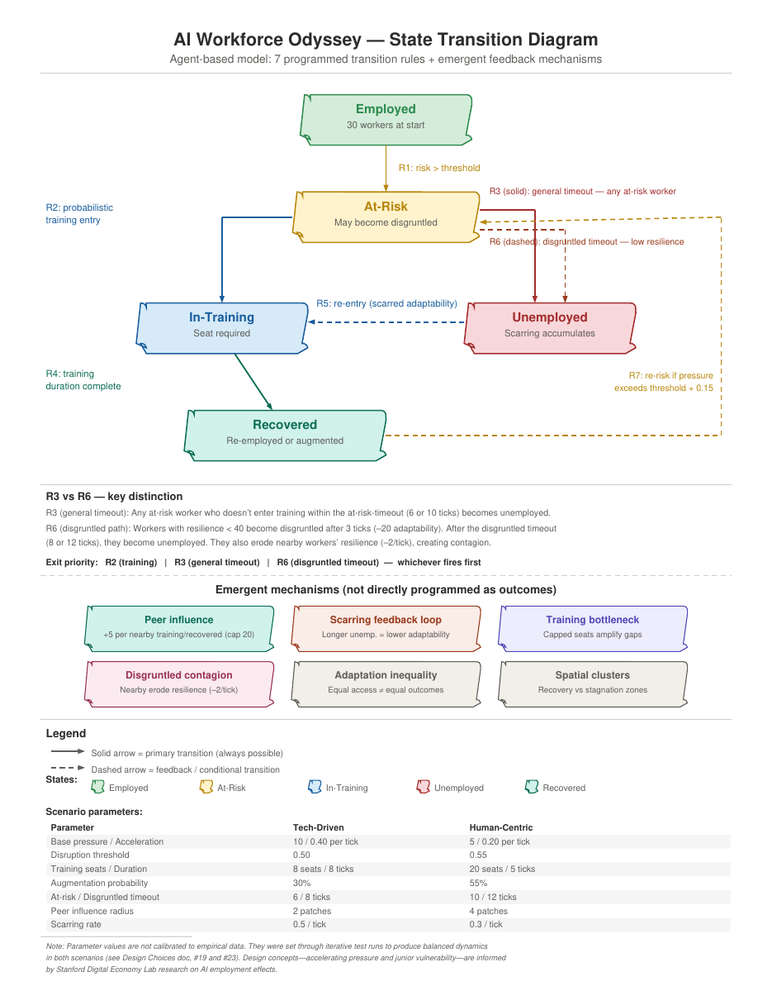
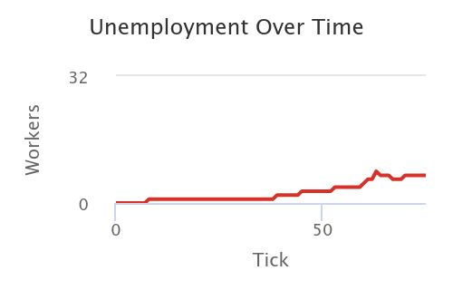
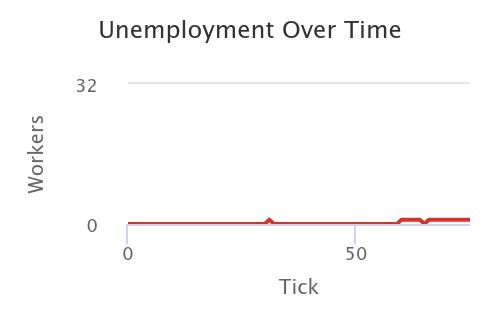
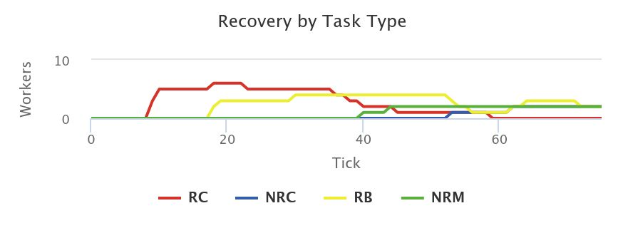
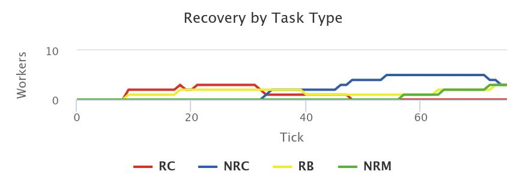

# AI Workforce Odyssey

**An agent-based simulation of how workers adapt when AI automation accelerates — and why equal access to training does not produce equal recovery.**

Built in NetLogo for *Agentic Technologies* (94815), Carnegie Mellon University, Spring 2026. Solo project by Asli Gulcur.

---

## The question

When AI disrupts a labor market, do workers who get the same access to retraining end up in the same place?

## The model

- **30 workers** in one labor market, simulated over **75 monthly ticks** of accelerating automation pressure.
- **4 task types** with different AI exposure: routine-cognitive (data entry, bookkeeping), non-routine cognitive (analysis, design), relationship-based (sales, partnerships) and non-routine manual (care work, trades).
- **3 seniority levels** (junior workers face higher disruption risk) and **2 behavioral traits**: *adaptability* (who enters and benefits from training) and *resilience* (who disengages under pressure).
- **5 states:** Employed → At-Risk → In-Training → Recovered (re-employed or AI-augmented), or Unemployed.
- **7 programmed transition rules:** threshold-based disruption, probabilistic training entry, timeouts, training completion, re-entry with "scarring", a disgruntled path for low-resilience workers, and re-risk for recovered workers.
- **Interaction mechanisms:** peer influence from nearby recovered or training workers, disgruntled contagion, scarring (the longer someone is unemployed, the less adaptable they become) and a cap on training seats.

Disruption risk = 0.50 × routine share + 0.30 × automation pressure (normalized) + 0.20 × seniority penalty.

## Two scenarios, same code

| Parameter | Tech-Driven Automation | Human-Centric Support |
|---|---|---|
| Base pressure / acceleration | 10 / 0.40 per tick | 5 / 0.20 per tick |
| Disruption threshold | 0.50 | 0.55 |
| Training seats / duration | 8 seats / 8 ticks | 20 seats / 5 ticks |
| Augmentation probability | 30% | 55% |
| At-risk / disgruntled timeout | 6 / 8 ticks | 10 / 12 ticks |
| Peer influence radius | 2 patches | 4 patches |
| Scarring rate | 0.5 / tick | 0.3 / tick |

## Results at tick 75

| Metric | Tech-Driven | Human-Centric |
|---|---|---|
| Employed | 6 | 8 |
| In training | 7 | 12 |
| **Unemployed** | **9** | **1** |
| Recovered | 5 | 6 |
| % augmented | 6.7% | 10% |
| Average time unemployed | 10.6 ticks | 5.3 ticks |
| Training seats still available | 1 | 8 |

**Unemployment over time** — Tech-Driven (left) vs Human-Centric (right)

 

**Recovery by task type** — Tech-Driven (top) vs Human-Centric (bottom). RC = routine-cognitive, NRC = non-routine cognitive, RB = relationship-based, NRM = non-routine manual.

## What emerged (not programmed)

- **Adaptation inequality.** Workers with identical training access diverged: some recovered quickly, others became trapped.
- **Unemployment traps.** Scarring created a feedback loop — longer unemployment, lower adaptability, lower re-entry — leaving a persistent tail of unemployed routine-cognitive juniors under Tech-Driven automation.
- **Recovery and stagnation clusters.** Peer effects produced pockets of recovery near early recoverers and stagnation where no one had recovered.
- **Queue amplification under stress.** Training seats were deliberately a *secondary* constraint. They never bound under Human-Centric support (8 seats still free at the end) and bound only during peak disruption waves under Tech-Driven automation.

**Finding:** the 9-vs-1 unemployment gap is *not* explained by seat scarcity. It comes from the interaction of disruption speed, scarring and peer support. Human-centric support doesn't just raise recovery overall — it equalizes outcomes across task types. Routine-cognitive workers recover first but lose that recovery under sustained pressure; non-routine workers recover later but more durably.

## Run it

**In the browser (no install):** open [NetLogo Web](https://www.netlogoweb.org/launch), choose *Browse*, and load `AI_Workforce_Odyssey.nlogo`.

**Desktop:** install [NetLogo 6.4](https://ccl.northwestern.edu/netlogo/download.shtml) and open `AI_Workforce_Odyssey.nlogo`.

Then click **Tech-Driven** or **Human-Centric** to load a scenario's parameters, **Setup**, then **Go**. Every parameter is exposed as a slider. Colors: green = employed, yellow = at-risk, orange = disgruntled, blue = in training, red = unemployed, white = re-employed, cyan = augmented. Shapes: circle = junior, square = mid, triangle = senior.

## Repository

| Path | Contents |
|---|---|
| `AI_Workforce_Odyssey.nlogo` | The model (NetLogo 6.4.0) |
| `docs/Memo.pdf` | Analysis memo: design, emergent mechanisms, scenario results, reflection |
| `docs/Design_Choices.pdf` | Every significant design choice and its rationale (iterated v1 → v3.2) |
| `docs/State_Transition_Diagram.pdf` | States, transition rules, emergent mechanisms and scenario parameters |
| `figures/` | Charts from the memo and the state diagram |

## Limitations

Workers are the only agents (firm strategy and policy are scenario parameters). The population is fixed at 30 with no entry or exit, spatial proximity stands in for professional networks, and parameters were tuned through test runs rather than calibrated to empirical data. Design concepts — accelerating pressure and junior-worker vulnerability — are informed by Stanford Digital Economy Lab research (see Reference).

## Reference

Brynjolfsson, E., Chandar, B., & Chen, R. *[Canaries in the Coal Mine? Six Facts about the Recent Employment Effects of Artificial Intelligence](https://digitaleconomy.stanford.edu/publication/canaries-in-the-coal-mine-six-facts-about-the-recent-employment-effects-of-artificial-intelligence/).* Stanford Digital Economy Lab, working paper (2025; revised August 2026).

The model's accelerating automation pressure and higher disruption risk for junior workers draw on the paper's finding that employment declines in AI-exposed occupations are concentrated among early-career workers and have grown over time.

## Notes

Generative AI (Claude, ChatGPT) assisted with design review and code generation; design decisions, testing, tuning and analysis are my own.

**Related projects from the same course:** [StockTrader](https://github.com/asligulcur/StockTrader_Signals_Strategies_2026) (competing LLM strategy agents) · [The AI Bidding War](https://github.com/asligulcur/The_AI_Bidding_War_April_2026) (governed multi-agent procurement negotiation).
